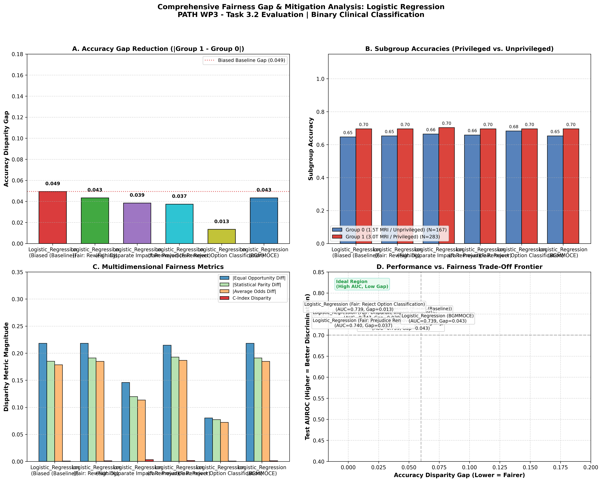

# PATH WP3 - Task 3.2: AI Fairness & Bias Reporting Instructions

[](https://www.python.org/downloads/)
[](LICENSE)
[](tests/)
[](path_fairness/)

> **Official Reporting Guidelines and Tutorial for Horizon Europe PATH Consortium (Work Package 3, Task 3.2).**  
> Standardized protocol and modular Python toolkit for evaluating, reporting, and visualizing **algorithmic fairness, discrimination, and subgroup disparities** in clinical and biomedical artificial intelligence models.

---

## 📋 Table of Contents
1. [Project Overview & Objectives](#-project-overview--objectives)
2. [Toolkit Architecture](#-toolkit-architecture)
3. [Quickstart (3-Step Execution)](#-quickstart-3-step-execution)
4. [Standardized Metric Definitions & Interpretations](#-standardized-metric-definitions--interpretations)
5. [The Standardized 4-Panel Fairness Figure](#-the-standardized-4-panel-fairness-figure)
6. [Step-by-Step Python Tutorial](#-step-by-step-python-tutorial)
7. [Integration into Custom Workflows](#-integration-into-custom-workflows)
8. [Partner Reporting Deliverables Checklist](#-partner-reporting-deliverables-checklist)
9. [Citation & Acknowledgments](#-citation--acknowledgments)

---

## 🎯 Project Overview & Objectives

In clinical healthcare and biomedical machine learning, predictive models often exhibit unintended performance disparities across acquisition sites, scanner hardware (e.g. 1.5 Tesla vs. 3.0 Tesla MRI), scanner vendors (GE, Philips, Siemens), or patient demographic cohorts (sex, age, ethnicity).

**PATH Work Package 3 (Task 3.2)** mandates a unified framework for consortium partners to:
1. **Audit models consistently** using identical mathematical formulations for discrimination, calibration, and algorithmic fairness.
2. **Prevent threshold bias** by assessing both threshold-dependent parity (e.g. Equal Opportunity, Statistical Parity) and continuous risk-ranking parity (**C-Index Disparity**).
3. **Produce standardized, publication-grade 4-Panel figures** that map performance-fairness Pareto trade-off frontiers.

---

## 🏗 Toolkit Architecture

The repository provides modular, production-ready Python classes designed with zero mandatory deep-learning dependencies (runs purely on standard `numpy`, `scipy`, `pandas`, `scikit-learn`, and `matplotlib`):

```
PATH_WP3-T3.2_Reporting_Instructions/
├── path_fairness/
│   ├── __init__.py             # Clean package exports
│   ├── metrics.py              # Separate Class: FairnessMetricsReporter
│   ├── visualization.py        # Separate Class: FairnessFigureGenerator
│   └── datasets.py             # Reproducible synthetic biomedical data generator
├── tutorial_fairness_reporting.py   # Standalone end-to-end runnable Python script
├── tutorial_notebook.ipynb     # Interactive Jupyter Notebook tutorial
├── tutorial_output/            # Pre-generated tutorial artifacts
│   ├── fairness_4panel_diagnostic.png
│   └── metrics_comparison.csv
├── tests/
│   └── test_metrics_and_plots.py # Automated unit test suite
├── requirements.txt            # Minimal environment dependencies
├── pyproject.toml              # Modern package metadata
└── README.md                   # This instruction manual
```

---

## ⚡ Quickstart (3-Step Execution)

### Step 1: Clone the repository
```bash
git clone https://github.com/trivizakis/PATH_WP3-T3.2_Reporting_Instructions.git
cd PATH_WP3-T3.2_Reporting_Instructions
```

### Step 2: Install dependencies
```bash
pip install -r requirements.txt
```

### Step 3: Run the end-to-end tutorial
```bash
python tutorial_fairness_reporting.py
```
This will train baseline and fair mitigation models on a biased biomedical dataset, compute all metrics, export `tutorial_output/metrics_comparison.csv`, and render the publication-grade diagnostic figure `tutorial_output/fairness_4panel_diagnostic.png`.

---

## 📊 Standardized Metric Definitions & Interpretations

The `FairnessMetricsReporter` class computes a multi-faceted evaluation across four complementary dimensions:

### 1. Global Performance & Discrimination
| Metric | Formula | Interpretation | Optimal Target |
| :--- | :--- | :--- | :---: |
| **Accuracy** | $\frac{TP + TN}{N}$ | Overall proportion of correct predictions across all patients. | $\to 1.0$ |
| **Balanced Accuracy** | $\frac{1}{2}(\text{Sensitivity} + \text{Specificity})$ | Prevents misleading accuracy inflation on imbalanced clinical cohorts. | $\to 1.0$ |
| **AUROC (AUC)** | Area under Receiver Operating Characteristic | Probability that a randomly chosen diseased patient receives a higher predicted risk than a non-diseased patient. | $\to 1.0$ |
| **Harrell's C-Index** | $P(\hat{p}_i > \hat{p}_j \mid y_i = 1, y_j = 0)$ | Equivalent to AUROC for binary clinical outcomes; measures risk ranking concordance. | $\to 1.0$ |

### 2. Probabilistic Calibration
| Metric | Formula | Interpretation | Optimal Target |
| :--- | :--- | :--- | :---: |
| **Brier Score** | $\frac{1}{N}\sum (\hat{p}_i - y_i)^2$ | Mean squared error between continuous probabilities and binary outcomes. | $\to 0.0$ |
| **Index of Prediction Accuracy (IPA)** | $1 - \frac{\text{Brier}}{\text{Brier}_{\text{null}}}$ | Proportion of predictive variance explained relative to a naive model predicting the prevalence base rate. | $\to 1.0$ |
| **Expected Calibration Error (ECE)** | $\sum_{m=1}^M \frac{\|B_m\|}{N} \|\text{acc}(B_m) - \text{conf}(B_m)\|$ | Weighted average discrepancy between model confidence and observed true positive frequency across probability bins. | $\to 0.0$ |

### 3. Multi-Dimensional Algorithmic Fairness Disparities
Let $s=1$ denote the **Privileged group** (e.g. 3.0T MRI, reference vendor) and $s=0$ denote the **Unprivileged group** (e.g. 1.5T MRI).

| Metric | Mathematical Formula | Clinical / Fairness Interpretation | Optimal Value |
| :--- | :--- | :--- | :---: |
| **Accuracy Disparity Gap** | $\|\text{Acc}_{s=1} - \text{Acc}_{s=0}\|$ | Absolute disparity in classification accuracy between subgroups. | **$0.0$** |
| **Equal Opportunity Difference (EOD)** | $\text{TPR}_{s=1} - \text{TPR}_{s=0}$ | Disparity in sensitivity (disease detection rate). Negative values indicate the unprivileged group suffers higher false negative rates. | **$0.0$** |
| **Statistical Parity Difference (SPD)** | $P(\hat{y}=1 \mid s=1) - P(\hat{y}=1 \mid s=0)$ | Disparity in positive selection rates regardless of true disease status. | **$0.0$** |
| **Disparate Impact (DI)** | $\frac{P(\hat{y}=1 \mid s=0)}{P(\hat{y}=1 \mid s=1)}$ | Ratio of unprivileged to privileged selection rates (Four-Fifths Rule considers $0.80 \le \text{DI} \le 1.25$ acceptable). | **$1.0$** |
| **Average Odds Difference (AOD)** | $\frac{1}{2}\left[(\text{FPR}_1 - \text{FPR}_0) + (\text{TPR}_1 - \text{TPR}_0)\right]$ | Average disparity across both false positive and true positive error rates. | **$0.0$** |
| **C-Index Disparity** | $\|\text{C-Index}_{s=1} - \text{C-Index}_{s=0}\|$ | **Threshold-free risk discrimination gap**. Quantifies whether continuous risk ranking degrades on disadvantaged hardware or demographics. | **$0.0$** |
| **Theil Index** | $\frac{1}{N}\sum \frac{b_i}{\bar{b}} \ln\left(\frac{b_i}{\bar{b}}\right)$ | Generalized entropy inequality of individual model benefit ($b_i = \hat{y}_i - y_i + 1$). | **$0.0$** |

---

## 📈 The Standardized 4-Panel Fairness Figure

Each report must generate the canonical 4-panel diagnostic figure using `FairnessFigureGenerator`:



### Panel Breakdown:
- **Panel A: Accuracy Gap Reduction ($|\text{Group 1} - \text{Group 0}|$)**
  - Displays the accuracy gap for every evaluated model.
  - Features a red dotted reference line marking the Biased Baseline level.
  - Lower bars indicate superior parity.
- **Panel B: Subgroup Accuracies (Privileged vs. Unprivileged)**
  - Grouped bars displaying classification accuracy for **Group 0 (Unprivileged)** and **Group 1 (Privileged)** only.
  - Includes subgroup cohort sizes in the legend (e.g. `Group 0 (N=167)`, `Group 1 (N=283)`).
- **Panel C: Multidimensional Fairness Metrics**
  - Multi-metric comparative bars displaying:
    - $|EOD|$ (Equal Opportunity Difference)
    - $|SPD|$ (Statistical Parity Difference)
    - $|AOD|$ (Average Odds Difference)
    - C-Index Disparity
- **Panel D: Performance vs. Fairness Trade-Off Frontier**
  - Plots diagnostic power (**Test AUROC**, Y-axis) against fairness disparity (**Accuracy Gap**, X-axis).
  - Traces the **Pareto Frontier** (non-dominated solutions).
  - Highlights the **Ideal Region** (Top-Left: High AUC, Low Gap).
  - Employs **smart collision-avoidance label placement with pointer arrows** to ensure legible model annotations.

---

## 🧑‍💻 Step-by-Step Python Tutorial

### 1. Initializing the Metrics Reporter
```python
from path_fairness import FairnessMetricsReporter

# Initialize reporter (Group 1 = Privileged, Group 0 = Unprivileged)
reporter = FairnessMetricsReporter(
    privileged_group=1,
    unprivileged_group=0,
    sensitive_name="scanner_field_strength"
)
```

### 2. Logging Model Predictions
Partners can log any machine learning or deep learning model by providing its test predictions:
```python
reporter.add_evaluation(
    model_name="ResNet50_Radiomics",
    variant="Biased (Baseline)",
    y_true=y_test,       # Ground truth labels [0, 1]
    y_pred=y_preds,      # Binary predictions [0, 1]
    y_prob=y_probs,      # Continuous positive-class probabilities [0.0, 1.0]
    s_true=s_test,       # Sensitive attribute [0, 1]
    training_split="Test"
)
```

### 3. Exporting the Summary Table
```python
# Print formatted markdown table
reporter.print_summary_table()

# Export standardized CSV table
reporter.to_csv("my_experiment_metrics.csv")
```

### 4. Generating the 4-Panel Figure
```python
from path_fairness import FairnessFigureGenerator

df_results = reporter.get_summary_dataframe()
generator = FairnessFigureGenerator()

fig, axes = generator.generate_4panel_figure(
    df_metrics=df_results,
    title="Comprehensive Fairness Gap Analysis: Prostate MRI\nPATH WP3 - Task 3.2 Evaluation",
    baseline_variant_name="Biased (Baseline)",
    privileged_label="3.0 Tesla MRI (Privileged)",
    unprivileged_label="1.5 Tesla MRI (Unprivileged)",
    save_path="my_experiment_4panel.png",
    dpi=300
)
```

---

## 🔧 Integration into Custom Workflows

Whether your model is implemented in **Scikit-Learn**, **PyTorch**, **XGBoost**, or **MONAI**, integration requires only saving `y_true`, `y_pred`, `y_prob`, and `s_test`:

```python
# Example PyTorch / MONAI evaluation loop
model.eval()
with torch.no_grad():
    probs = torch.sigmoid(model(X_test_tensor)).cpu().numpy().flatten()
    preds = (probs >= 0.5).astype(int)

# Pass directly to PATH reporter
reporter.add_evaluation(
    model_name="MONAI_DenseNet",
    variant="Fair: Reweighed",
    y_true=y_test_numpy,
    y_pred=preds,
    y_prob=probs,
    s_true=s_test_numpy
)
```

---

## 📝 Partner Reporting Deliverables Checklist

When submitting Task 3.2 deliverables, please ensure the following artifacts are produced:

- [ ] **`metrics_comparison.csv`**: Standardized CSV file generated via `reporter.to_csv()`. Must include:
  - `AUC`, `Accuracy`, `C_Index`, `Brier_Score`, `IPA`, `ECE`
  - `Acc_Group_0`, `Acc_Group_1`, `N_Group_0`, `N_Group_1`
  - `Accuracy_Gap`, `Equal_Opportunity_Diff`, `Statistical_Parity_Diff`, `Average_Odds_Diff`, `C_Index_Disparity`, `Theil_Index`
- [ ] **`fairness_4panel_diagnostic.png`**: High-resolution (300 DPI) 4-panel figure comparing the biased baseline against all explored mitigation strategies.
- [ ] **Subgroup Specification**: Clearly document which subgroup is defined as `Group 0 (Unprivileged)` and `Group 1 (Privileged)` (e.g. 1.5T vs 3.0T; Vendor A vs Vendor B).

---

## 📜 Citation & License

This project is licensed under the MIT License - see the [LICENSE](LICENSE) file for details.

If you use this toolkit in your work, please cite:
```bibtex
@misc{path_wp3_fairness_2026,
  author = {Trivizakis, Eleftherios},
  title = {PATH WP3 - Task 3.2: AI Fairness & Bias Reporting Toolkit for Biomedical Machine Learning},
  year = {2026},
  publisher = {GitHub},
  howpublished = {\url{https://github.com/trivizakis/PATH_WP3-T3.2_Reporting_Instructions}}
}
```

